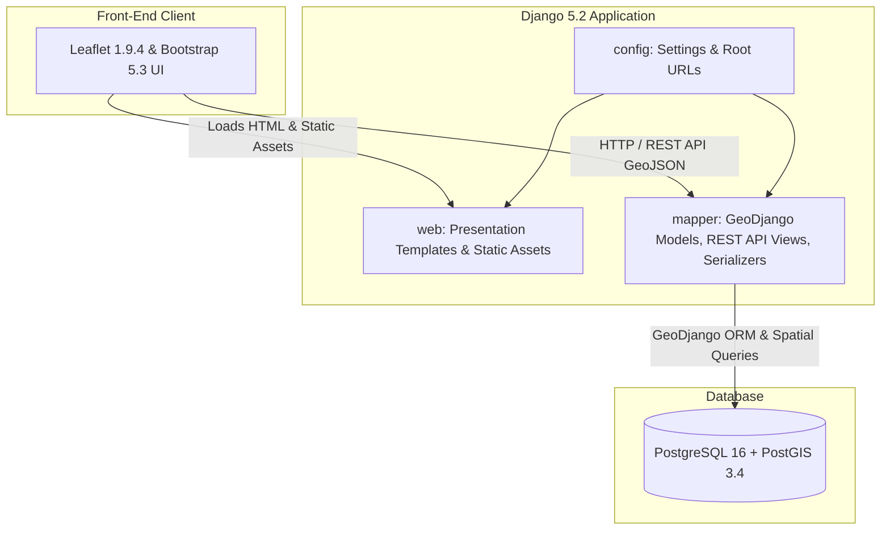
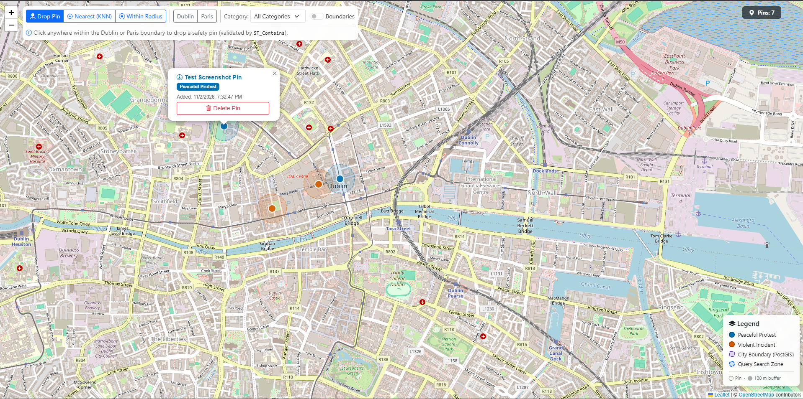
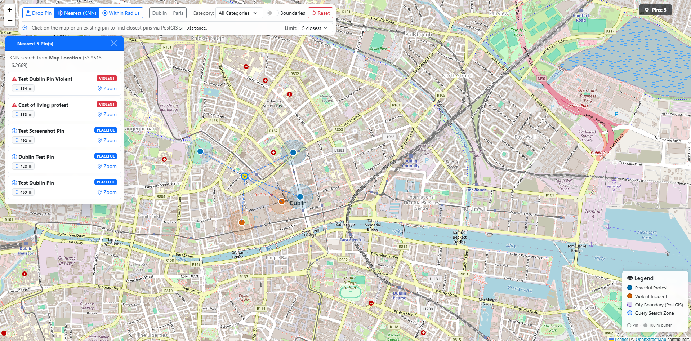

# Urban Safety & Protest Mapper

A location based web application for tracking peaceful and violent aspects of protests within major cities (currently Dublin and Paris). Users drop pins on an interactive map; the application stores each pin as a PostGIS point and automatically generates a 100-metre impact buffer polygon.

## Features

- Create / read / delete safety pins inside registered city boundaries. Points outside every boundary are rejected server-side.
- Automatic 100-metre PostGIS buffer per pin, generated both by a Python `ST_Buffer(...::geography, 100)` call and by a Postgres `BEFORE INSERT/UPDATE` trigger, so any write path (ORM, admin, raw SQL) stays consistent.
- Spatial queries:
    * Nearest-N pins (PostGIS `ST_Distance` ordering, GiST-indexed)
    * Within radius, in true metres (`ST_DWithin` on `geography`)
    * Bounding-box containment (`ST_Within`)
    * City containment on create (`ST_Contains` against CityBoundary)
- Leaflet 1.9.4 + OpenStreetMap tiles with three interaction modes (drop / nearest / radius), category filter, city-jump buttons, boundary toggle, live result panel, and colour-blind-safe palette.
- Django admin (`GISModelAdmin`) for CRUD.
- Test suite covering GeoJSON shapes, filters, boundary rejection, KNN ordering, radius edge cases, and invalid input.

## Setup (local, Docker)

    cp .env.example .env
    docker compose up --build -d
    docker compose exec web python manage.py migrate
    docker compose exec web python manage.py createsuperuser   # optional and only needed once

- Map:     http://localhost:8000/
- Admin:   http://localhost:8000/admin/
- pgAdmin: http://localhost:5050/   (credentials from .env)

## API Documentation

All responses are GeoJSON unless noted.

| Method | Path                          | Description |
|--------|-------------------------------|-------------|
| GET    | /api/v1/pins/                 | FeatureCollection. Optional `?category=PEACEFUL\|VIOLENT` and `?bbox=min_lon,min_lat,max_lon,max_lat`. |
| POST   | /api/v1/pins/                 | Create a pin. Body: `{"title","description","category","latitude","longitude"}`. Returns 201 Feature with `buffer_geom`. 400 if outside all city boundaries. |
| GET    | /api/v1/pins/{id}/            | Single Feature. |
| DELETE | /api/v1/pins/{id}/            | 204 on success. |
| GET    | /api/v1/pins/nearest/         | `?lat&lon&limit[&category]`. Returns `{center, limit, count, features[]}` ordered by distance. `distance` property is in metres. |
| GET    | /api/v1/pins/within/          | `?lat&lon&radius_m[&category]`. `radius_m` is true metres (1..100000). |
| GET    | /api/v1/boundaries/           | FeatureCollection of all CityBoundary polygons. |

## Architecture

Component responsibilities:
- `config/` — settings, URL root, WSGI/ASGI.
- `mapper/` — models, serializers, views, tests, migrations. Only app that
  owns spatial logic.
- `web/`     — single template (`web/map.html`) and static assets
  (`web/static/web/{css,js}`). No backend logic.

## Database Schema

See `mapper/migrations/` for authoritative schema. Summary:

    CityBoundary
      id           bigserial PK
      name         varchar(100) UNIQUE
      geom         geometry(Polygon, 4326)     -- GIST-indexed
      created_at   timestamptz
      updated_at   timestamptz

    SafetyPin
      id           bigserial PK
      title        varchar(200)
      description  text
      category     varchar(20)  -- PEACEFUL | VIOLENT
      geom         geometry(Point, 4326)       -- GIST-indexed
      buffer_geom  geometry(Polygon, 4326)     -- GIST-indexed, auto-generated
      created_at   timestamptz
      updated_at   timestamptz

    Trigger trg_safetypin_buffer
      BEFORE INSERT OR UPDATE OF geom, buffer_geom
      ON mapper_safetypin
      Recomputes buffer_geom := ST_Buffer(NEW.geom::geography, 100)::geometry
      whenever geom changes (or buffer_geom is null).

## Screenshots

## Known Issues / Limitations

- Pins can only be edited via Django admin; the REST API exposes GET and DELETE only.

## GitHub Repository Link

URL: https://github.com/DanielKearney2/WMA
